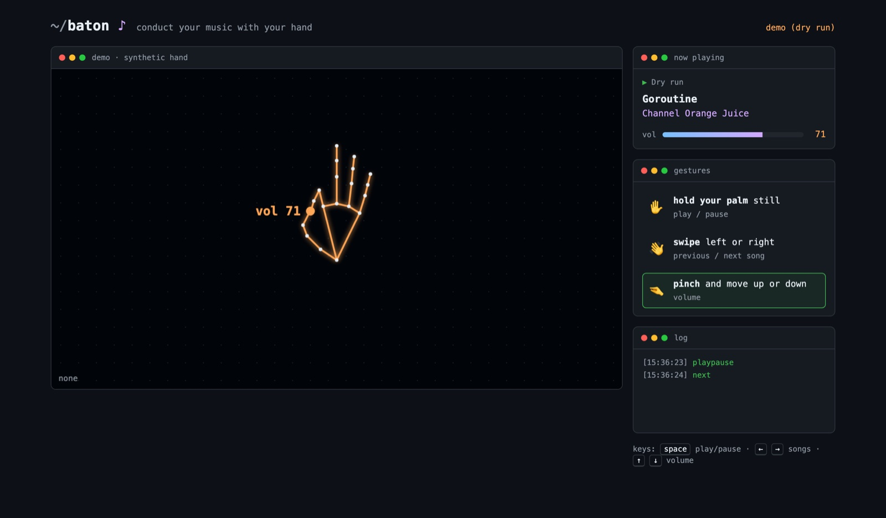

# baton

Conduct the music on your Mac with your hand. baton watches your hand through the webcam and plays, pauses, skips and turns the volume up and down in **Spotify** or **Apple Music**. No clicks, no keyboard.



| Gesture | Does |
|:--|:--|
| ✋ **Hold your open palm** still for a moment | Play / pause |
| 👋 **Swipe** your hand left or right | Previous / next song |
| 🤏 **Pinch** your thumb and index finger, then move up or down | Volume, like turning a knob in the air |

It's one Go binary with no dependencies: it serves a page where [MediaPipe](https://ai.google.dev/edge/mediapipe/solutions/vision/gesture_recognizer) tracks your hand, and turns the gestures into AppleScript.

## Run it

Requires macOS, Go 1.23+ and a webcam.

```bash
go install github.com/candedefranco/baton@latest
baton
```

baton opens `http://localhost:7373` in your browser. Allow the camera, open Spotify or Music, and show it your hand.

The first time you play or skip, macOS asks whether your terminal may control Spotify (or Music). Say yes; you can change it later in **System Settings → Privacy & Security → Automation**.

| Flag | |
|:--|:--|
| `--dry-run` | Pretend to be a music player instead of touching the real one. Works on any OS |
| `--port 7373` | Port to listen on (always localhost) |
| `--no-open` | Don't open the browser |

Open **`/?demo`** to watch a synthetic hand perform every gesture, no camera needed. Against a real player the demo only pretends, so it never changes your music.

The keyboard works too: <kbd>space</kbd> play/pause, <kbd>←</kbd> <kbd>→</kbd> songs, <kbd>↑</kbd> <kbd>↓</kbd> volume.

## How it works

```text
browser                                                   Go (localhost only)
──────────────────────────────────────────                ─────────────────────────────────
webcam ─▶ MediaPipe Gesture Recognizer                    internal/server
            │ 21 hand landmarks + "Open_Palm", …   POST     token + Host checks
            ▼                                     ──────▶      │
          gestures.js: hold · swipe · pinch      /api/action   ▼
            │ playpause / next / previous / volume          internal/player
            ▼                                                  │ osascript
          page: hand overlay, now playing, log    ◀──────      ▼
                                                 /api/state   Spotify · Music · system volume
```

- **Gestures are a pure state machine.** [`web/gestures.js`](web/gestures.js) takes frames (time, MediaPipe's label, landmarks) and returns commands, with no camera or DOM involved. The tests feed it synthetic hands frame by frame. The `?demo` page drives it with the same synthetic hand.
- **Telling gestures apart.**
  - **Hold:** an open palm kept still for 600 ms.
  - **Swipe:** the palm crosses 20% of the frame in under 350 ms, mostly sideways. A slow drift or a vertical move isn't a swipe.
  - **Pinch:** starts when the thumb–index gap drops below 0.3 palm sizes, and only ends above 0.45, so it doesn't flicker on and off.
  - **One command per gesture:** after each command there's a short cooldown, and the hand has to close before it can pause again. That way, an open hand left in view after a swipe doesn't also pause.
- **Volume follows the hand.** While you pinch, the bar moves every frame and the server gets the new level at most every 90 ms, plus the final one.
- **One player at a time.** baton checks the process list for Spotify, then Music, and only then names the app in a script. AppleScript would otherwise make macOS ask where an app that isn't installed is.

### Security

Any web page you have open can send requests to `localhost`, so a local server that controls your Mac needs some care:

- It only listens on `127.0.0.1`.
- It only answers requests addressed to its own host name. That stops [DNS rebinding](https://en.wikipedia.org/wiki/DNS_rebinding), where a site points its own domain at your machine.
- Every API call must carry a random token that's generated at startup and only appears inside the page baton serves. Other sites can't read that page, so they can't forge commands.
- Scripts are fixed templates: the app comes from a list of two, the action from a list of three, and the volume is a clamped number. Nothing from a request ever reaches a shell.

## Development

```bash
go test ./...                    # player and server, with fakes
node --test web/*.test.js        # gesture logic
go run . --dry-run               # try it without touching your music
BATON_INTEGRATION=1 go test ./internal/player -run RealMac -v   # reads your Mac's real state, changes nothing
```

CI runs the Go tests on Linux and macOS and the gesture tests on Node.

## License

[MIT](LICENSE)
